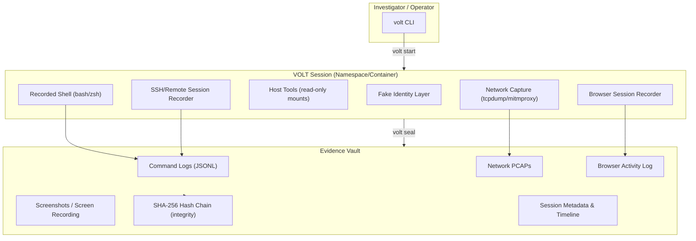
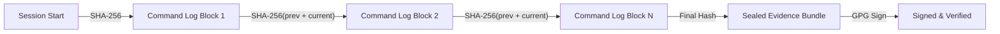

# 🔒 VOLT — Forensic Evidence Collection & Audit Environment

> **Volatile Observation & Logging Terminal**
> A sandboxed, evidence-grade environment for cybersecurity auditing, penetration testing, and digital forensics — with full session recording and chain-of-custody integrity.

---

## 📋 Analysis of Original Vision

From the [README.md](file:///mwp/volt/README.md), the core idea is:

> [!IMPORTANT]
> **CORE PRINCIPLE: VOLT records EVERYTHING by default.** There are no flags to enable recording. The moment a session starts, all activity is automatically captured — commands, network, browser, keystrokes, file changes, everything. The operator never thinks about "what to record."

| Requirement | Interpretation |
|---|---|
| "Bubble wrap" folder | An **isolated sandbox environment** that wraps around programs |
| Fake root & fake OS info | A **spoofed system identity** (fake hostname, OS, hardware) to deceive malware or protect investigator identity |
| `hardware_profile.txt` auto-generated | Auto-generated **fake hardware fingerprint** (laptop model, motherboard, serial numbers, etc.) |
| Mount host tools read-only | **Bind-mount host binaries** (read-only) into the sandbox — tools available, but no config/data leakage |
| **Record ALL things by default** | **Everything is captured automatically** — commands, stdout/stderr, keystrokes, network packets, HTTP(S), browser activity, DNS, SSH sessions, file changes. No opt-in. Always on. |
| SSH/remote recording | Automatically record all **remote sessions** (SSH, RDP) — commands and responses |
| Firefox/browser recording | Automatically capture **network traffic** + **browser activity** (URLs, HTTP methods, POST/GET data, downloads, cookies) |
| Host network, isolated filesystem | Use the **host's real network stack** but run in a **filesystem-isolated** container |

---

## 🏗️ Architecture Overview



---

## 🧩 Module Breakdown

### Module 1: `volt-core` — Session Manager & CLI
**Purpose:** Main entry point. Creates, manages, and destroys VOLT sessions.

| Feature | Details |
|---|---|
| `volt init <case-name>` | Initialize a new evidence case directory |
| `volt start [--profile <hw-profile>]` | Launch an isolated VOLT session |
| `volt stop` | Gracefully stop session, finalize logs |
| `volt seal` | Hash-chain all evidence, generate integrity report |
| `volt status` | Show active sessions |
| `volt export <format>` | Export evidence bundle (tar.gz, ZIP with manifest) |

**Tech:** Rust binary (`clap` CLI), manages Linux namespaces via `nix` crate, async with `tokio`.

---

### Module 2: `volt-sandbox` — Isolation & Fake Identity Layer
**Purpose:** Create the sandboxed environment with spoofed identity.

#### 2a: Filesystem Isolation
- Use **Linux namespaces** (`unshare`) or **bubblewrap** (`bwrap`) for filesystem isolation
- Mount an **overlay filesystem** (read-only base + writable scratch layer)
- Bind-mount host tools (`/usr/bin`, `/usr/sbin`) as **read-only**
- Block access to host user data (`$HOME`, `/etc/shadow`, etc.)

#### 2b: Fake System Identity
Auto-generate or load from profile:

| Spoofed Artifact | Example |
|---|---|
| `/etc/hostname` | `DESKTOP-A3K9F2X` |
| `/etc/os-release` | Windows 10 / Ubuntu 22.04 (configurable) |
| `/sys/class/dmi/id/product_name` | `Dell Latitude 5520` |
| `/sys/class/dmi/id/board_vendor` | `Dell Inc.` |
| `/sys/class/dmi/id/bios_version` | `1.14.0` |
| `/proc/cpuinfo` | Spoofed CPU model |
| MAC address | Randomized or spoofed |
| Disk serial numbers | Fake serials |

#### 2c: Hardware Profile Generator (`volt-hwgen`)
- Generate realistic hardware profiles from templates
- Profiles stored as `hardware_profile.json`
- Presets: `laptop-dell`, `desktop-hp`, `server-lenovo`, `vm-virtualbox`, `vm-vmware`
- Custom profile editor

---

### Module 3: `volt-recorder` — Full Session Audit Logger
**Purpose:** Record everything that happens inside the session.

#### 3a: Shell Recorder
- Wrap the shell with **`script`** or a custom PTY recorder
- Capture: timestamp, command, full stdout/stderr, exit code, working directory, user
- Output format: **JSONL** (one JSON object per command)

```json
{
  "ts": "2026-11-14T22:50:01.123Z",
  "seq": 42,
  "cwd": "/evidence/case-001",
  "cmd": "nmap -sV 192.168.1.0/24",
  "stdout": "Starting Nmap 7.94...",
  "stderr": "",
  "exit_code": 0,
  "duration_ms": 34210,
  "sha256": "a1b2c3d4..."
}
```

#### 3b: SSH/Remote Session Recorder
- **Intercept SSH** via a wrapper script (`volt-ssh`) that logs the session
- Use `ssh -o ProxyCommand` or a custom SSH wrapper
- Record: remote host, commands sent, responses received
- Support for other protocols: `telnet`, `ftp`, `rdp` (via `rdesktop`/`xfreerdp` session recording)

#### 3c: Keystroke & Terminal Recorder
- Optionally record raw keystrokes (for evidence of exact operator actions)
- **asciinema**-compatible terminal recording for replay

---

### Module 4: `volt-netcap` — Network Traffic Capture
**Purpose:** Capture all network activity from the session.

| Feature | Tool |
|---|---|
| Full packet capture | `tcpdump` / `tshark` → PCAP files |
| HTTP/HTTPS inspection | `mitmproxy` in transparent mode |
| DNS query logging | Capture DNS requests/responses |
| Browser traffic | Log all URLs, methods, headers, POST bodies |
| Connection timeline | Generate timeline of all connections |

- **Auto-rotate** PCAPs at configurable size (e.g., 100MB)
- **Real-time tagging**: Mark traffic with case/session metadata
- Uses host network (no NAT / no virtual network)

---

### Module 5: `volt-browser` — Browser Activity Recorder
**Purpose:** Record all browser activity with forensic detail.

| Feature | Details |
|---|---|
| URL logging | Every URL visited with timestamp |
| HTTP method & data | GET params, POST bodies, response codes |
| Screenshot capture | Auto-screenshot on page load (optional) |
| Cookie/storage logging | Record cookies, localStorage, sessionStorage |
| Download tracking | Log all file downloads with hashes |

**Approach:**
- Launch Firefox/Chromium with a **custom proxy** (mitmproxy)
- Inject a **browser extension** for deep activity logging
- OR use **Playwright** for fully instrumented browser sessions

---

### Module 6: `volt-evidence` — Evidence Vault & Integrity
**Purpose:** Ensure all collected evidence has forensic integrity.

#### Chain of Custody


| Feature | Details |
|---|---|
| Hash chain | Every log entry includes hash of previous entry (blockchain-style) |
| Tamper detection | Verify integrity with `volt verify <case>` |
| GPG signing | Optionally sign the evidence bundle |
| Timestamps | NTP-synced timestamps, RFC 3339 format |
| Evidence manifest | JSON manifest listing all artifacts with hashes |
| Export formats | `.volt` (custom), `.tar.gz`, forensic standards (CASE/UCO) |

---

## 📁 Project Structure

```
volt/
├── README.md
├── setup.py / pyproject.toml
├── volt/
│   ├── __init__.py
│   ├── cli.py                    # Main CLI entry point
│   ├── core/
│   │   ├── session.py            # Session lifecycle management
│   │   ├── config.py             # Configuration handling
│   │   └── case.py               # Case/evidence directory management
│   ├── sandbox/
│   │   ├── namespace.py          # Linux namespace management
│   │   ├── overlay.py            # Overlay filesystem setup
│   │   ├── mounts.py             # Read-only tool mounting
│   │   └── identity.py           # Fake identity/hardware spoofing
│   ├── recorder/
│   │   ├── shell.py              # Shell command recorder
│   │   ├── ssh.py                # SSH session recorder
│   │   ├── terminal.py           # Terminal session (asciinema-style)
│   │   └── keylog.py             # Keystroke logger (optional)
│   ├── network/
│   │   ├── capture.py            # Packet capture (tcpdump/tshark)
│   │   ├── proxy.py              # MITM proxy for HTTP(S)
│   │   └── dns.py                # DNS query logger
│   ├── browser/
│   │   ├── recorder.py           # Browser activity recorder
│   │   ├── extension/            # Browser extension for deep logging
│   │   └── proxy_config.py       # Browser proxy configuration
│   ├── evidence/
│   │   ├── vault.py              # Evidence storage management
│   │   ├── hashchain.py          # Hash chain integrity
│   │   ├── manifest.py           # Evidence manifest generator
│   │   ├── signer.py             # GPG signing
│   │   └── exporter.py           # Export to various formats
│   ├── hwgen/
│   │   ├── generator.py          # Hardware profile generator
│   │   ├── templates/            # Hardware profile templates
│   │   │   ├── laptop-dell.json
│   │   │   ├── desktop-hp.json
│   │   │   ├── vm-virtualbox.json
│   │   │   └── vm-vmware.json
│   │   └── profiles/             # User-created profiles
│   └── utils/
│       ├── logging.py            # Structured logging
│       ├── crypto.py             # Hashing & crypto utilities
│       └── timestamps.py         # NTP-synced timestamp handling
├── tests/
│   ├── test_sandbox.py
│   ├── test_recorder.py
│   ├── test_network.py
│   ├── test_evidence.py
│   └── test_hwgen.py
├── docs/
│   ├── usage.md
│   ├── architecture.md
│   └── evidence-formats.md
└── profiles/                     # Default hardware profiles
```

---

## 🔧 Technology Stack

| Layer | Technology | Why |
|---|---|---|
| Language | **Rust** (2021) | Maximum wire speed, zero GC pauses, memory safety, single static binary |
| CLI Framework | **clap** | Fast, type-safe CLI with auto-generated help |
| Sandboxing | **bubblewrap** (`bwrap`) + Linux namespaces | Lightweight, no daemon, kernel-level containment |
| Capabilities | **CAP_NET_RAW** preserved | Allows `nmap -sS`, `masscan`, `tcpdump` raw packet operations |
| Overlay FS | **OverlayFS** (kernel) | Copy-on-write isolation (host files never modified) |
| Shell Recording | Custom **PTY** wrapper (`nix`/`libc`) | Zero-lag raw terminal capture to JSONL |
| Network Capture | **libpcap** (`pcap` crate) + `tcpdump` | Industry-standard PCAP at line rate |
| HTTP(S) Proxy | **mitmproxy** | SSL inspection, transparent proxying |
| Browser Automation | **Playwright** / `xcb` | Deep browser instrumentation & screenshots |
| Hashing | **SHA-256** (`ring` crate) | Hardware-accelerated forensic-grade integrity |
| Signing | **GnuPG** (`gpgme` crate) | Evidence authentication |
| Config | **TOML** | Human-readable config |
| Log Format | **JSONL** | Structured, parseable, streamable |

---

## 🚀 Implementation Phases

### Phase 1: Foundation (Week 1-2)
> [!IMPORTANT]
> Get the core sandbox and basic recording working first.

- [ ] Project scaffolding (pyproject.toml, CLI skeleton)
- [ ] `volt init` / `volt start` / `volt stop` commands
- [ ] Basic sandbox using `bwrap` (filesystem isolation)
- [ ] Read-only host tool mounting
- [ ] Basic shell command recording (JSONL output)
- [ ] Case directory management

### Phase 2: Identity Spoofing (Week 3)
- [ ] Hardware profile generator (`volt-hwgen`)
- [ ] Fake `/proc`, `/sys` entries via bind mounts
- [ ] Fake hostname, OS release, MAC address
- [ ] Profile templates (Dell, HP, VirtualBox, etc.)
- [ ] `volt start --profile vm-virtualbox`

### Phase 3: Advanced Recording (Week 4-5)
- [ ] SSH session wrapper & recorder
- [ ] Terminal session recording (asciinema format)
- [ ] Keystroke logging (optional, with consent flag)
- [ ] Remote session support (telnet, RDP)

### Phase 4: Network Capture (Week 5-6)
- [ ] Automatic tcpdump on session start
- [ ] mitmproxy integration for HTTP(S) inspection
- [ ] DNS query logging
- [ ] PCAP rotation & management
- [ ] Connection timeline generation

### Phase 5: Browser Recording (Week 6-7)
- [ ] Browser launch through MITM proxy
- [ ] URL/method/data logging
- [ ] Browser extension for deep activity capture
- [ ] Screenshot-on-load feature
- [ ] Download tracking with hashing

### Phase 6: Evidence Integrity & Export (Week 7-8)
- [ ] Hash chain implementation (blockchain-style)
- [ ] `volt seal` — finalize and hash all evidence
- [ ] `volt verify` — integrity verification
- [ ] GPG signing of evidence bundles
- [ ] Export to `.tar.gz` with manifest
- [ ] CASE/UCO format support (forensic standard)

### Phase 7: Polish & Hardening (Week 9-10)
- [ ] Comprehensive test suite
- [ ] Documentation & usage guides
- [ ] Edge case handling (crash recovery, partial sessions)
- [ ] Performance optimization
- [ ] Security audit of the tool itself

---

## 💡 Example Usage Flow

```bash
# 1. Initialize a new forensic case
$ volt init --case "IR-2026-0042" --investigator "Agent Smith"

# 2. Start an isolated session with a fake hardware profile
$ volt start --profile vm-virtualbox --capture-network --capture-browser

# 3. You're now inside the VOLT sandbox
[VOLT:IR-2026-0042] $ whoami
investigator

[VOLT:IR-2026-0042] $ cat /sys/class/dmi/id/product_name
VirtualBox

[VOLT:IR-2026-0042] $ nmap -sV 192.168.1.100
# (output recorded automatically)

[VOLT:IR-2026-0042] $ ssh admin@192.168.1.100
# (SSH session recorded automatically)

[VOLT:IR-2026-0042] $ firefox https://suspicious-site.com
# (browser activity + network traffic captured)

# 4. Exit and seal the evidence
[VOLT:IR-2026-0042] $ exit

$ volt seal --sign --gpg-key "agent.smith@agency.gov"
✓ 847 commands recorded
✓ 3 PCAP files (142MB total)
✓ 23 browser sessions logged
✓ Hash chain verified (SHA-256)
✓ Evidence bundle signed (GPG)
✓ Exported: IR-2026-0042.volt (148MB)

# 5. Verify evidence integrity later
$ volt verify IR-2026-0042.volt
✓ All 847 log entries verified
✓ Hash chain intact
✓ GPG signature valid (Agent Smith <agent.smith@agency.gov>)
```

---

## ⚠️ Key Design Decisions Needed

| Decision | Options | Recommendation |
|---|---|---|
| **Sandboxing tech** | bubblewrap vs Docker vs raw namespaces | **bubblewrap** — lightweight, no daemon, no root |
| **Network mode** | Host network vs bridged | **Host network** — matches original vision, simpler |
| **Browser recording** | Proxy-based vs extension vs Playwright | **Proxy (mitmproxy)** — works with any browser |
| **Evidence format** | Custom vs CASE/UCO standard | **Both** — custom for speed, CASE/UCO for legal use |
| **Root requirement** | Root vs rootless | **Rootless where possible**, root for `/proc`/`/sys` spoofing |
| **Target OS** | Linux only vs cross-platform | **Linux first**, macOS later, Windows via WSL2 |

---

> [!TIP]
> This tool essentially creates a **forensic-grade "bubble"** around the investigator's activities — like a cleanroom for cyber operations. Every action is recorded, every artifact is hashed, and the environment itself is disguised.
