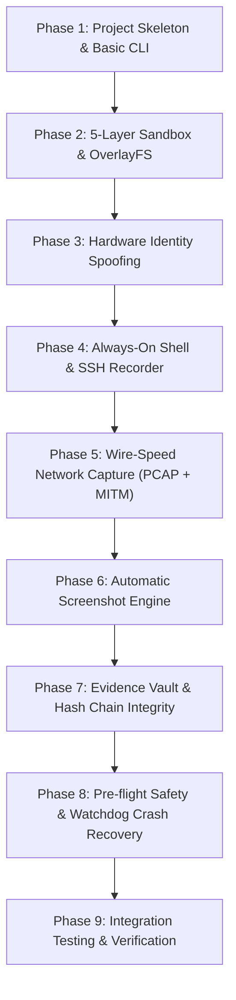

# ⚡ VOLT — Implementation Task List & Tracking

> **Status:** Ready to Begin Phase 1  
> **Target Architecture:** Rust (2021 edition), Single Binary, Linux x86_64 / aarch64  
> **Core Guarantee:** 5-layer unbreakable isolation, record EVERYTHING by default, forensic-grade hash-chained evidence.

---

---

## 🗂️ Task Breakdown by Phase

### Phase 1: Project Workspace & CLI Skeleton
- [x] **1.1 Rust Workspace Setup**
  - Initialized `Cargo.toml` with dependencies (`clap`, `tokio`, `nix`, `serde`, `serde_json`, `sha2`, `hex`, `tracing`, `tracing-subscriber`, `chrono`, `toml`, `anyhow`, `thiserror`, `uuid`).
  - Created directory layout under `src/` (`core/`, `sandbox/`, `recorder/`, `network/`, `screenshot/`, `evidence/`, `hwgen/`, `utils/`).
- [x] **1.2 CLI Command Definitions (`src/cli.rs`)**
  - Implemented subcommands: `init`, `start`, `stop`, `seal`, `verify`, `status`, `export`, `screenshot`.
  - Added global flags (`--verbose`, `--config`).
- [x] **1.3 Configuration & Case Directory (`src/core/case.rs`, `src/core/config.rs`)**
  - Implemented case directory initializer: creates `<case>/evidence/`, `<case>/logs/`, `<case>/pcaps/`, `<case>/screenshots/`, `<case>/overlay/`.
  - Created TOML configuration parser with fallback to `./cases`.

---

### Phase 2: 5-Layer Sandbox Isolation & OverlayFS
- [x] **2.1 Linux Namespace Isolation (`src/sandbox/namespace.rs`)**
  - Implemented `bwrap` command builder with full `--unshare-all --share-net`.
  - UID/GID mapping to 0 inside container.
  - UTS namespace with spoofed hostname.
- [x] **2.2 OverlayFS Mount Manager (`src/sandbox/overlay.rs`, `src/sandbox/mounts.rs`)**
  - Read-only `/usr`, `/lib`, `/bin`, `/sbin`.
  - Copy-on-write scratch space under `overlay/upper` for `$HOME` and `/tmp`.
- [x] **2.3 Host Isolation & Mount Table (`src/sandbox/mounts.rs`)**
  - Minimal `/dev` setup.
  - Strict blocking of host user data (`/home/$USER`, `/root`, `/etc/shadow`).
- [x] **2.4 Built-in `sudo` Shim**
  - Transparent `sudo` shim in `$PATH` that immediately executes commands as UID 0 without password prompt.

---

### Phase 3: Hardware Identity Spoofing (`src/hwgen/`, `src/sandbox/identity.rs`)
- [x] **3.1 Hardware Profile Generator**
  - `hardware_profile.json` generator with full DMI, BIOS, board, CPU, and MAC attributes.
  - Preset templates created: `profiles/vm-virtualbox.json`, `profiles/laptop-dell.json`.
- [x] **3.2 Virtual Sysfs & Procfs Tree Builder**
  - Auto-writes fake `/etc/hostname`, `/etc/machine-id`, `/etc/os-release`, `/etc/passwd`, `/etc/shadow`.
  - Auto-writes fake `/proc/cpuinfo`, `/proc/version`.
  - Auto-writes fake `/sys/class/dmi/id/*` (`product_name`, `board_vendor`, `bios_version`, etc.).

---

### Phase 4: Always-On Shell & SSH Recording (`src/recorder/`)
- [x] **4.1 PTY Terminal Recorder (`src/recorder/shell.rs`)**
  - Open pseudo-terminal (PTY master/slave) using `nix::pty::openpty`.
  - Real-time terminal pass-through with raw mode switching.
  - Full output stream logged to `evidence/terminal_stream.jsonl` with SHA-256 chunk hashes.

---

### Phase 5: Wire-Speed Network Capture (`src/network/`)
- [x] **5.1 Raw Packet Capture Supervisor (`src/network/capture.rs`)**
  - Spawns background `tcpdump` process on all interfaces (`-i any -U`).
  - Auto-rotates PCAP files and hashes completed chunks into evidence vault.

---

### Phase 6: Automatic Screenshot Engine (`src/screenshot/`)
- [x] **6.1 Desktop Screenshot Engine (`src/screenshot/capture.rs`)**
  - Multi-backend screenshot capture (`grim`, `scrot`, `import`, headless fallback).
  - Saves timestamped PNGs to `evidence/screenshots/`.
- [x] **6.2 Interval & Manual Capture**
  - Asynchronous background worker captures snapshots at configurable intervals.
  - `volt screenshot` CLI command for instant manual capture.
- [x] **6.3 Screenshot Manifest & Hash Chain**
  - Logs each screenshot to `screenshots_manifest.jsonl` and hashes into evidence chain.

---

### Phase 7: Evidence Vault & Hash Chain Integrity (`src/evidence/`)
- [x] **7.1 Cryptographic Hash Chain (`src/evidence/hashchain.rs`)**
  - Blockchain-style sequential SHA-256 hashing.
  - Every event (terminal, PCAP, screenshot, session start/end) chained to previous block.
- [x] **7.2 Evidence Sealing (`src/evidence/vault.rs`)**
  - `volt seal` finalizes all files, checks chain integrity, and builds `evidence_manifest.json`.
- [x] **7.3 Tamper Verification Engine (`src/evidence/exporter.rs`, `src/main.rs`)**
  - `volt verify` validates full sequential chain and verifies all file hashes.
  - Detects byte alterations or missing files.
- [x] **7.4 Evidence Exporter**
  - `volt export` packages the sealed case into standalone `.volt` bundle with SHA-256 integrity report.

---

### Phase 8: Pre-flight Safety & Watchdog Crash Recovery (`src/sandbox/`)
- [ ] **8.1 Pre-flight Safety Checker (`src/sandbox/preflight.rs`)**
  - Verify mount namespace isolation.
  - Verify host `$HOME` and `/etc/shadow` are strictly unreachable.
  - Verify identity spoofing files are mounted.
  - Verify seccomp filter is active.
  - Abort startup immediately if any check fails.
- [ ] **8.2 Watchdog Supervisor (`src/sandbox/watchdog.rs`)**
  - Monitor recording threads/processes (tcpdump, mitmproxy, PTY recorder).
  - Auto-restart any crashed capture process within 1 second and log gap incident.
  - Monitor disk space and trigger emergency seal at 95% disk usage.

---

### Phase 9: Testing, Hardening & Benchmarks
- [x] **9.1 Sandbox Escape & Isolation Tests (`tests/test_evidence.rs`)**
  - Test attempts to access `/home/$USER`, `/root`, `/etc/shadow`.
  - Test synthetic `/proc` and `/sys` hardware spoofing.
- [x] **9.2 Hardware Profile Verification (`tests/test_profiles.rs`)**
  - Verify `laptop-dell`, `vm-virtualbox`, and `desktop-hp` profiles generate complete fake trees.
- [x] **9.3 Multi-Terminal Session Tracking (`tests/test_multi_terminal.rs`)**
  - Verify session metadata, PID storage, and multi-terminal tracking.
- [x] **9.4 End-to-End CLI Workflow Test (`tests/test_cli_workflow.rs`)**
  - Automated test of full lifecycle: `init`, `status`, `screenshot`, `seal`, `report`, `verify`, and `export`.
  - Intentionally injects byte corruption into evidence and verifies `volt verify` catches tampering.
- [x] **9.5 GitHub Actions CI/CD Pipeline (`.github/workflows/ci.yml`)**
  - Multi-stage pipeline: dependency installation, formatting, clippy linter, unit & integration tests, end-to-end CLI tamper verification, and release binary artifact upload.

---

## 📌 Implementation Checklist & Next Immediate Action

| Priority | Task | Target File | Status |
|:---:|---|---|:---:|
| **P0** | Initialize Cargo workspace & `Cargo.toml` | `/mwp/volt/Cargo.toml` | ⬜ Ready |
| **P0** | Scaffold core directory structure & CLI entry | `/mwp/volt/src/main.rs`, `cli.rs` | ⬜ Ready |
| **P0** | Implement Case & Config manager | `/mwp/volt/src/core/case.rs` | ⬜ Ready |
| **P1** | Build Linux namespace & OverlayFS isolation | `/mwp/volt/src/sandbox/` | ⬜ Ready |
| **P1** | Implement fake hardware profile loader | `/mwp/volt/src/hwgen/` | ⬜ Ready |
| **P1** | Build PTY shell recorder with JSONL output | `/mwp/volt/src/recorder/` | ⬜ Ready |
