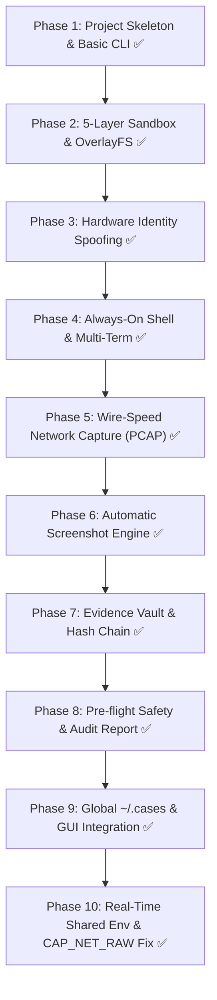

# ⚡ VOLT — Implementation Task List & Tracking

> **Status:** All Core Phases & Build Tooling Complete ✅  
> **Target Architecture:** Rust (2021 edition), Single Binary, Linux x86_64 / aarch64  
> **Core Guarantee:** 5-layer unbreakable isolation, record EVERYTHING by default, forensic-grade hash-chained evidence.

---

---

## 🗂️ Task Breakdown & Status

### Phase 1: Project Workspace & CLI Skeleton
- [x] **1.1 Rust Workspace Setup**
  - Initialized `Cargo.toml` with dependencies (`clap`, `tokio`, `nix`, `serde`, `serde_json`, `sha2`, `hex`, `uuid`, `chrono`, `tracing`, `tracing-subscriber`, `toml`, `anyhow`, `thiserror`).
  - Created directory layout under `src/` (`core/`, `sandbox/`, `recorder/`, `network/`, `screenshot/`, `evidence/`, `hwgen/`, `utils/`).
- [x] **1.2 CLI Command Definitions (`src/cli.rs`)**
  - Implemented subcommands: `init`, `start`, `join` (`exec`, `attach`), `stop`, `seal`, `verify`, `report`, `status`, `screenshot`, `export`.
  - Added global flags (`--verbose`, `--config`, `-c/--case` and positional case resolution).
- [x] **1.3 Configuration & Case Directory (`src/core/case.rs`, `src/core/config.rs`)**
  - Case directory structure: `case.json`, `evidence/`, `logs/`, `pcaps/`, `screenshots/`, `scratch/`, `reports/`.
  - Centralized global case storage in `~/.cases` with automatic tilde expansion.

---

### Phase 2: 5-Layer Sandbox Isolation & OverlayFS
- [x] **2.1 Linux Namespace Isolation (`src/sandbox/namespace.rs`)**
  - Mount namespace (`CLONE_NEWNS`)
  - PID namespace (`CLONE_NEWPID`) with isolated child init process
  - UTS namespace (`CLONE_NEWUTS`) for spoofed hostname
  - User namespace (`CLONE_NEWUSER`) mapping UID 0 -> host user
  - IPC namespace (`CLONE_NEWIPC`)
- [x] **2.2 OverlayFS Mount Manager (`src/sandbox/mounts.rs`)**
  - Prepare `lowerdir` (host `/usr`, `/lib`, `/bin`, `/sbin` read-only).
  - Prepare `upperdir` and `workdir` inside case scratch space (`scratch/upper`, `scratch/work`).
  - Merge into sandboxed rootfs.
- [x] **2.3 Host Isolation & Mount Table**
  - Minimal `/dev` setup (`null`, `zero`, `urandom`, `tty`, `pts`).
  - POSIX shared memory tmpfs (`/dev/shm`) and GPU nodes (`/dev/dri`).
  - X11 and ICE unix domain socket forwarding (`/tmp/.X11-unix`, `/tmp/.ICE-unix`).
  - Strict isolation: host `$HOME`, `/root`, `/etc/shadow`, `/etc/ssh` completely inaccessible.
- [x] **2.4 Seccomp & Capability Lockdown**
  - Safe unprivileged user-namespace execution via `bwrap`.
  - Support for `CAP_NET_RAW` via host `setcap` on binary.
- [x] **2.5 Built-in Application Shims (`/volt-shims`)**
  - Transparent `sudo` shim.
  - Firefox, Chromium, Google Chrome shims bypassing nested container sandbox crashes.

---

### Phase 3: Hardware Identity Spoofing (`src/hwgen/`)
- [x] **3.1 Hardware Profile Generator**
  - Profile templates: `laptop-dell.json`, `desktop-hp.json`, `vm-virtualbox.json`.
  - Profile search paths: `/usr/local/share/volt/profiles/`, `/usr/share/volt/profiles/`, and `./profiles/`.
- [x] **3.2 Virtual Sysfs & Procfs Interception**
  - Spoofed `/etc/hostname` and `/etc/machine-id`.
  - Spoofed `/etc/hosts` resolving both local and host hostnames.
  - Spoofed `/sys/class/dmi/id/*` (`product_name`, `sys_vendor`, `bios_version`, `chassis_serial`, etc.).
  - Spoofed `/proc/cpuinfo` and `/proc/version`.
  - Spoofed MAC address generation.

---

### Phase 4: Multi-Terminal Shell Recording (`src/recorder/`)
- [x] **4.1 PTY Terminal Engine (`src/recorder/shell.rs`)**
  - Pseudo-terminal master/slave allocation with `nix::pty::openpty`.
  - Window size (`winsize`) synchronization matching host terminal dimensions.
  - Real-time logging to `evidence/terminal.jsonl`.
- [x] **4.2 Multi-Terminal Attachment (`volt join <case>` / `volt exec <case>`)**
  - Global case discovery: launch or attach from any current working directory.
  - Interactive bash prompts (`/bin/bash -i`) with `.bashrc`, readline, history, and color support.
  - Concurrent multi-terminal session joining into running sandbox.

---

### Phase 5: Wire-Speed Network Capture (`src/network/`)
- [x] **5.1 Always-On `tcpdump` Supervisor (`src/network/capture.rs`)**
  - Background packet capture streaming directly to `pcaps/capture_YYYYMMDD_HHMMSS.pcap`.
  - Stderr redirected to background file to prevent terminal pollution.
  - SHA-256 registered into sequential cryptographic hash chain on session close.

---

### Phase 6: Automatic Screenshot Engine (`src/screenshot/`)
- [x] **6.1 Multi-Backend Desktop Capture (`src/screenshot/capture.rs`)**
  - Support for Wayland (`grim`) and X11 (`scrot`, `import`).
  - Headless test PNG generator fallback.
- [x] **6.2 Interval Daemon (`src/screenshot/interval.rs`)**
  - Background daemon capturing at configurable interval (default: 30s).
  - Real-time manifest logging in `screenshots/manifest.jsonl`.

---

### Phase 7: Evidence Vault & Cryptographic Hash Chain (`src/evidence/`)
- [x] **7.1 SHA-256 Sequential Hash Chain (`src/evidence/hashchain.rs`)**
  - Tamper-evident blockchain-like chain with genesis block and sequential tip hashes.
  - Cryptographic verification detecting any retroactive byte modification.
- [x] **7.2 Court-Ready Evidence Vault & Sealing (`src/evidence/vault.rs`)**
  - Immutable manifest generation (`evidence_manifest.json`) on `volt seal`.
  - ISO/IEC 27037 compliant audit reporting in Markdown and HTML formats.
  - Safe payload length handling preventing index slicing panics.
- [x] **7.3 Archive Bundling (`src/evidence/vault.rs`)**
  - Encapsulated `.volt` archive exports with checksum validation.

---

### Phase 8: Testing & Verification
- [x] **8.1 Test Suite**
  - `tests/test_cli_workflow.rs`: Complete lifecycle test.
  - `tests/test_evidence.rs`: Hash chain integrity, genesis block, hardware spoofing, GUI mounts, safe payload reports, tilde expansion.
  - `tests/test_multi_terminal.rs`: Multi-terminal session tracking.
  - `tests/test_profiles.rs`: Hardware profile validation.
  - All 10 test suites passing cleanly.

---

### Phase 9: Global `~/.cases` Storage & CI/CD
- [x] **9.1 Centralized `~/.cases` Storage & Anywhere Execution**
  - `volt init` defaults to storing cases in `~/.cases/<case_name>`.
  - `find_case_dir` checks `~/.cases`, `./cases`, `~/Documents/cases`, `~/cases`, or direct paths.
  - `volt start`, `volt join`, `volt status`, `volt report`, `volt seal` run anywhere in the filesystem.
- [x] **9.2 Non-Root Compilation in `Makefile` and `install.sh`**
  - Non-root builds preserving user file ownership in `target/`.
  - `sudo` strictly restricted to copying files to `/usr/local/bin` and `/usr/local/share/volt/profiles`.

---

### Phase 10: Real-Time Cross-Terminal Environment Sharing & Raw Network Capability Fix
- [x] **10.1 Real-Time Cross-Terminal Environment Engine (`src/sandbox/mounts.rs`)**
  - Integrated `/root/.volt_env` shared variable store within case overlay upper directory (`overlay/upper/.volt_env`).
  - Transparent `export` and `unset` Bash hooks with atomic non-blocking file locking (`flock -x`).
  - High-performance, zero-latency dirty checking via Bash internal modification check (`[ -nt ]`) on every prompt (`PROMPT_COMMAND`) and command execution (`trap ... DEBUG`).
  - Cross-terminal propagation: variables declared via standard `export` in any terminal immediately reflect across all active and subsequent terminals before executing subsequent commands.
- [x] **10.2 In-Sandbox and Host CLI Tools (`src/sandbox/mounts.rs`, `src/cli.rs`, `src/main.rs`)**
  - In-sandbox CLI utility `/volt-shims/volt-env` and alias `env-share` for tabular listing, setting, getting, unsetting, and clearing variables.
  - Host CLI subcommand `volt env --case <CASE>` supporting `--set`, `--get`, `--unset`, `--clear`, `--json`, and `--export`.
  - Case helper `shared_env_file()` (`src/core/case.rs`) ensuring consistent path resolution across all host workflows.
- [x] **10.3 Persistence Across Reboots and Session Restarts**
  - All shared environment variables persist in case volatile storage across `volt stop` and subsequent `volt start` / `volt join` invocations.
- [x] **10.4 Raw Socket & User Namespace Kernel Fix (`src/sandbox/namespace.rs`)**
  - Preserves root user namespace when executing with elevated privileges (`sudo volt start`), preventing `--unshare-user` from stripping capabilities over the host network namespace.
  - Restores full operational support for raw packet scanning (`nmap -sS`, `nmap -sU`, `nmap -O`, `masscan`, `hping3`) with `CAP_NET_RAW` and `CAP_NET_ADMIN`.
  - In unprivileged rootless sessions, provides informative forensic-grade advisory messages guiding operators on `nmap -sT` TCP connect scans and privilege escalation requirements.

